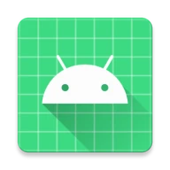
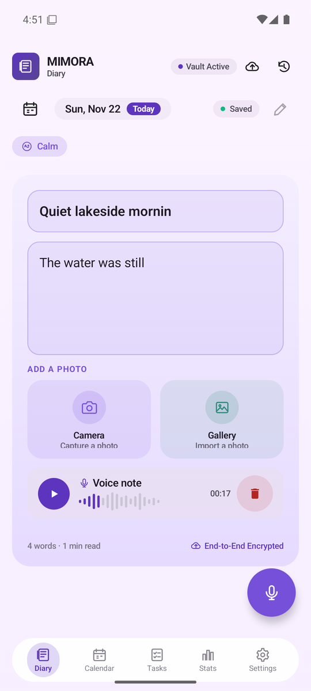
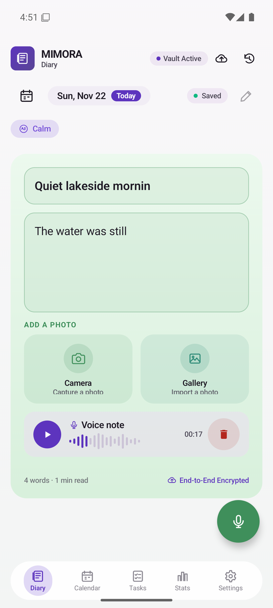
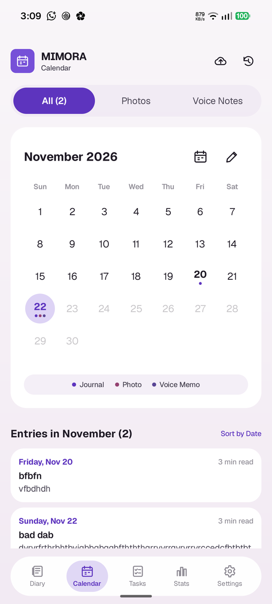
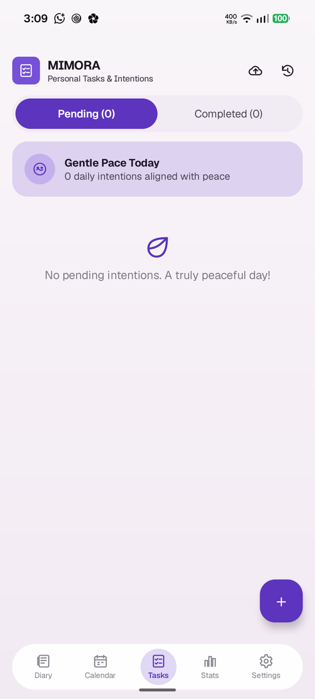
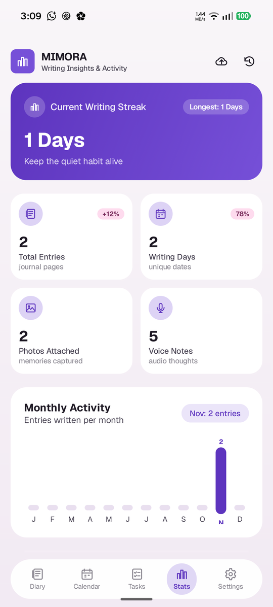
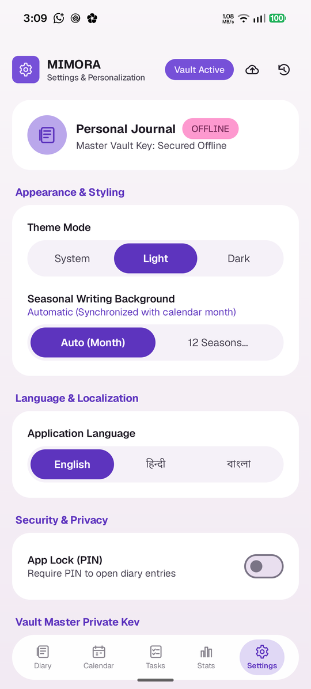
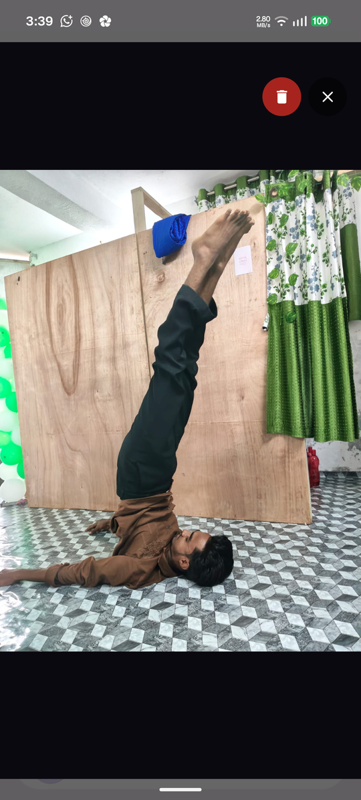

# MIMORA

### A serene, private sanctuary for your daily thoughts and memories.

**Offline-first journaling · End-to-end encrypted backup · Zero-knowledge by design**

[🌐 Website](https://iamrony27.github.io/mimora-site/) · [🔒 Privacy Policy](https://iamrony27.github.io/mimora-site/privacy.html) · [⬇️ Download APK](https://github.com/iamrony27/mimora-site/releases/latest)

---

## Why MIMORA?

Most diary apps quietly upload your deepest thoughts to someone else's servers. MIMORA doesn't. Your journal lives on your phone. If you *choose* to back it up, the archive is encrypted on your device with a key only you hold — Google stores nothing but opaque ciphertext.

No account required to write. No tracking. No ads. No central database of your memories.

---

## ✨ Features

| | | |
|:---:|:---:|:---:|
| **✍️ Beautiful writing canvas** | **🎨 Five canvas themes** | **💾 Autosave only** |
| Calm, chat-style page with doodle wallpaper | Lavender · Ocean · Meadow · Sunset · Rose | Every keystroke saved. No save button. |
| **📷 Photos & voice notes** | **🔐 Private by default** | **☁️ Encrypted backup** |
| Large camera/gallery cards, floating recorder | Fingerprint / PIN lock, protected deletes | One timestamped archive in your own Drive |

### More details

- **Offline-first** — write anywhere, no sign-in needed; everything works in airplane mode.
- **End-to-end encrypted backups** — AES-256-GCM with a 100,000-round PBKDF2 key derived from your 24-word phrase. Even Google cannot read your archive.
- **One backup, hidden away** — stored in the hidden `appDataFolder` of *your* Google Drive. MIMORA overwrites the same archive each sync; it can never see your other Drive files.
- **24-word recovery gate** — every restore surface requires all 24 words. Wrong key? Nothing is written.
- **Biometric unlock** — `BIOMETRIC_STRONG` with PIN fallback; the app relocks the moment it leaves the foreground.
- **Screenshot-proof** — `FLAG_SECURE` keeps your diary and recovery key out of screenshots, recordings, and the recents preview.
- **English-only, distraction-free** — no prompts, seasons, or language menus in your writing space.

---

## 📱 Screenshots

| Writing · Lavender | Writing · Meadow |
|:---:|:---:|
|  |  |

| Calendar | Tasks |
|:---:|:---:|
|  |  |

| Statistics | Settings |
|:---:|:---:|
|  |  |

| Fullscreen photo preview |
|:---:|
|  |

---

## ⬇️ Download & install

Grab the latest signed APK from the [Releases page](https://github.com/iamrony27/mimora-site/releases/latest), download `app-release.apk`, and open it on your Android 8+ device.

> **Note:** The recovery phrase shown on first setup is the *only* way to decrypt your backups. Write it down and store it somewhere safe — MIMORA has no servers and no recovery service.

---

## 🔐 Privacy & security

- **No analytics, no ads, no telemetry.**
- Diary data, photos, and voice notes stay in the app's private Android storage (`allowBackup=false`).
- The 24-word phrase is encrypted at rest with a non-exportable Android Keystore key; clipboard copies clear after 60 seconds.
- TLS-only networking; no cleartext traffic.
- Release APK is R8-obfuscated and verifies its own signing certificate at startup to deter tampering.
- Access tokens are requested per action and never stored.

Read the full [Privacy Policy](https://iamrony27.github.io/mimora-site/privacy.html).

---

## License

All rights reserved. © 2026 MIMORA.
